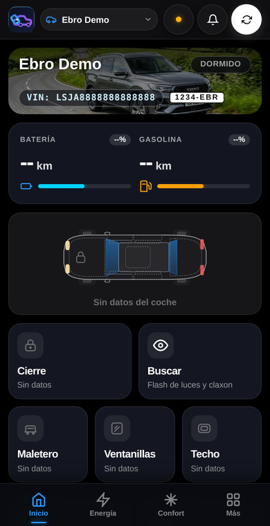
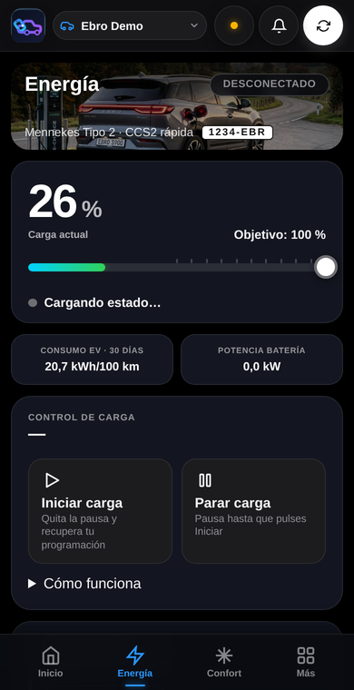
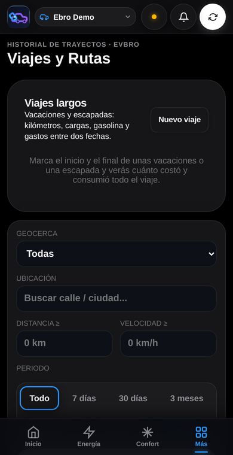
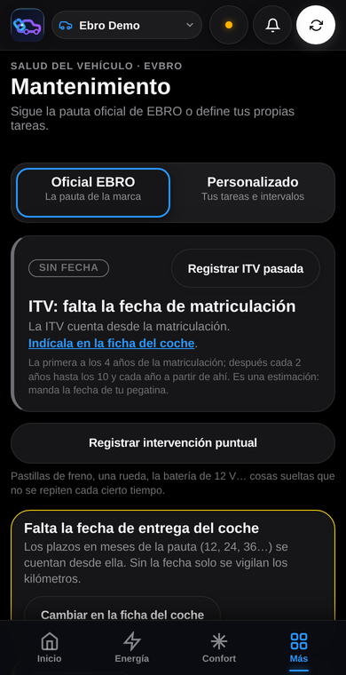
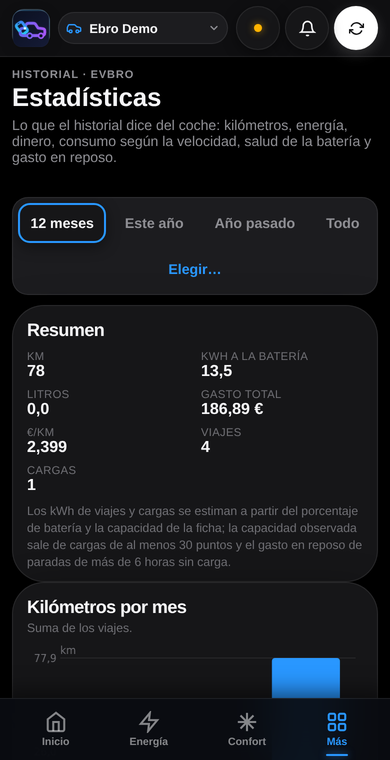

<p align="center">
  
</p>

<h1 align="center">EVBro</h1>
<p align="center"><strong>Your car's companion.</strong><br>
Your Ebro on your phone: live data, remote control, trips, charges, maintenance and costs. On your own server, no subscriptions.</p>

<p align="center"><strong>Project website:</strong> <a href="https://evbro.app">evbro.app</a> (in Spanish): screenshots, features and a demo to try it without installing anything.</p>

<p align="center"><strong>🌍 Language:</strong> <a href="README.md">Español</a> · <strong>English</strong></p>

<p align="center">
  <a href="https://github.com/jcortizronda/EVbro/releases"></a>
  <a href="https://github.com/jcortizronda/EVbro/actions/workflows/ci.yml"></a>
  <a href="https://github.com/jcortizronda/EVbro/pkgs/container/evbro"></a>
  <a href="LICENSE"></a>
  <a href="https://github.com/jcortizronda/EVbro/stargazers"></a>
</p>

---

## Contents

- [What it is](#what-it-is)
- [Screenshots](#screenshots)
- [What it does](#what-it-does)
- [Installation](#installation)
- [Documentation](#documentation)
- [Languages](#languages)
- [Support the project](#support-the-project)
- [Licence](#licence)

## What it is

EVBro is a **self-hosted** application for **Ebro** cars (S700, S800, S900 PHEV…). It talks to the Ebro cloud with the same protocol as the official app and gathers in one place what the official app does not keep: the car's full history, its maintenance, what it costs and the alerts that matter to you. It installs on a home computer with Docker, is used from the phone like an app, and the data never leaves your server.

## Screenshots

<p align="center">
  
  
  
  
  
</p>

## What it does

- **Live home screen:** battery, range, petrol, odometer, lock, doors, windows, sunroof, tyres and map, with a car figure that shows what is open.
- **Safe remote control:** lock, boot, windows, sunroof, climate, seats, steering wheel, defrost, alarm and "find me". Whatever **opens** the car asks for the PIN on every send. **Scheduled climate** by time and days.
- **Charging:** battery target, stop/start and schedule charging, curve and cost of each charge from the tariff of the place (fixed, free, Spanish 2.0TD or PVPC).
- **History:** trips with route (replay, GPX), journeys, frequent places, geofences with an arrival/departure log, fuel-ups with **real consumption** between fill-ups, expenses and cost balance, monthly statistics and battery health.
- **Maintenance:** official EBRO plan or a custom one, roadworthiness test, jobs with invoices, consumables and part numbers; car sheet with insurance and documents; **car book** as PDF.
- **Alerts:** phone notifications, Telegram, Pushover and webhook: geofences, charging, battery, fuel, windows left open, maintenance, tyre pressure and due dates.
- **Several accounts:** a manager with their cars, linked accounts by level (view, edit, control), invitations and a separate admin console.
- **Integrations:** Home Assistant (the cars appear on their own over MQTT) and GPS position from a Traccar server.
- **Your data is yours:** export the whole account as a ZIP, import it on another server, and a `/legal` page says plainly what is stored and who sees it.

## Installation

Two files, Docker and twenty minutes. The step-by-step guide, for people who have never set up a server: **[docs/en/install.md](docs/en/install.md)**.

```bash
mkdir -p ~/evbro && cd ~/evbro
curl -fsSLO https://raw.githubusercontent.com/jcortizronda/EVbro/main/deploy/docker-compose.yml
curl -fsSL  https://raw.githubusercontent.com/jcortizronda/EVbro/main/deploy/.env.example -o .env   # fill in the first block
docker compose pull && docker compose up -d
docker compose logs app | grep "código de configuración"   # setup code to create the administrator at http://IP:8082
```

The image is `ghcr.io/jcortizronda/evbro` (`latest` or `vX.Y.Z`); updating is `docker compose pull && docker compose up -d`. For HTTPS, phone alerts and backups, follow the guide.

## Documentation

| For | English | Español |
| :--- | :--- | :--- |
| Installing | [Installation guide](docs/en/install.md) | [Guía de instalación](docs/instalacion.md) |
| Using | [User manual](docs/en/manual.md) | [Manual de usuario](docs/manual.md) |
| Operating | — | [Despliegue, proxy, variables, copias](docs/deployment.md) · [Seguridad y datos](docs/security.md) |
| Developing | — | [Arquitectura](docs/architecture.md) · [Desarrollo y tests](docs/development.md) · [Interfaz](docs/frontend.md) · [Idiomas](docs/i18n.md) · [Viajes](docs/trips.md) · [Estadísticas](docs/stats.md) · [Costes](docs/costs.md) · [Mantenimiento](docs/maintenance.md) · [Consumibles](docs/parts.md) · [Traccar](docs/traccar.md) |

The operator and developer documentation is in Spanish for now.

## Languages

The app, the alerts, the car book and the console are in **Spanish, English and Portuguese**; every account picks its own in Settings → System.

## Support the project

If EVBro is useful to you, you can support its development:

[](https://ko-fi.com/jcortizronda)
[](https://www.paypal.me/jcortizronda/)

## Licence

[GPL-3.0](LICENSE). EVBro is not affiliated with Ebro or Chery.
