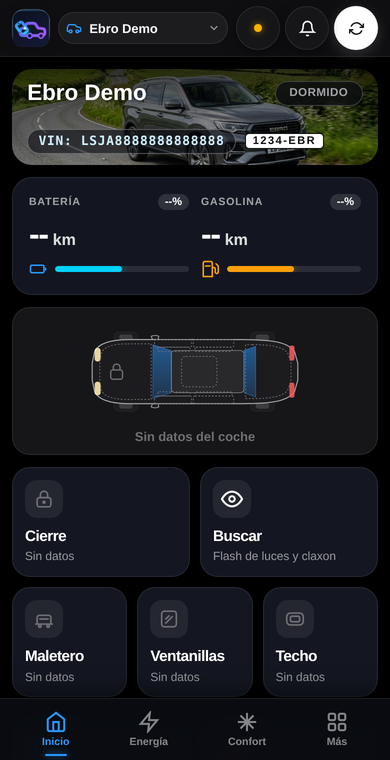
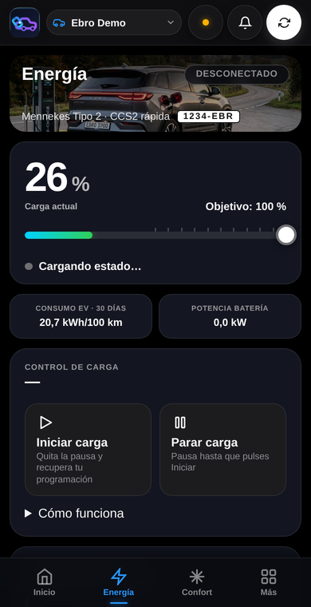
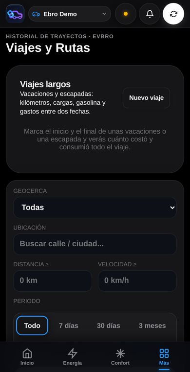
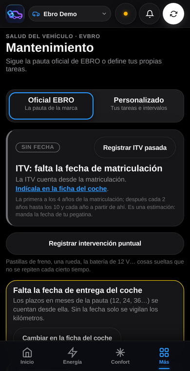
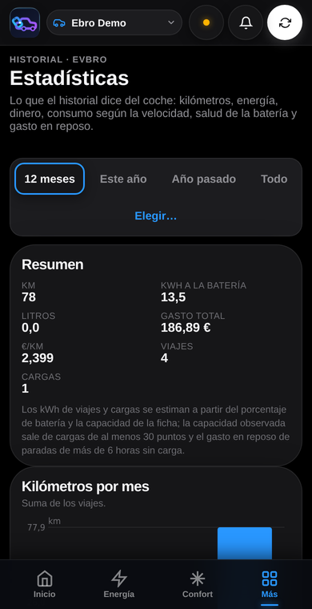

<p align="center">
  
</p>

<h1 align="center">EVBro</h1>
<p align="center"><strong>El compañero de tu coche.</strong><br>
Tu Ebro en el móvil: datos en directo, control remoto, viajes, cargas, mantenimiento y costes. En tu propio servidor, sin suscripciones.</p>

<p align="center"><strong>🌍 Idioma:</strong> <strong>Español</strong> · <a href="README.en.md">English</a></p>

<p align="center">
  <a href="https://github.com/jcortizronda/EVbro/releases"></a>
  <a href="https://github.com/jcortizronda/EVbro/actions/workflows/ci.yml"></a>
  <a href="https://github.com/jcortizronda/EVbro/pkgs/container/evbro"></a>
  <a href="LICENSE"></a>
  <a href="https://github.com/jcortizronda/EVbro/stargazers"></a>
</p>

---

## Índice

- [Qué es](#qué-es)
- [Capturas](#capturas)
- [Qué hace](#qué-hace)
- [Instalación](#instalación)
- [Documentación](#documentación)
- [Idiomas](#idiomas)
- [Qué no está probado todavía](#qué-no-está-probado-todavía)
- [Apoya el proyecto](#apoya-el-proyecto)
- [Licencia](#licencia)

## Qué es

EVBro es una aplicación **autoalojada** para coches **Ebro** (S700, S800, S900 PHEV…). Habla con la nube de Ebro con el mismo protocolo que la app oficial y junta en un solo sitio lo que la app oficial no guarda: el historial completo del coche, su mantenimiento, lo que cuesta y los avisos que te importan. Se instala en un ordenador de casa con Docker, se usa desde el móvil como una app y los datos no salen de tu servidor.

## Capturas

<p align="center">
  
  
  
  
  
</p>

## Qué hace

- **Inicio en vivo:** batería, autonomía, gasolina, odómetro, cierre, puertas, ventanillas, techo, neumáticos y mapa, con una figura del coche que enseña lo que está abierto.
- **Control remoto seguro:** cierre, maletero, ventanillas, techo, clima, asientos, volante, desempañado, alarma y «localizar». Lo que **abre** el coche pide el PIN en cada envío. **Climatización programada** por hora y días.
- **Energía:** objetivo de batería, parar/iniciar y programar la carga, curva y coste de cada carga según la tarifa del sitio (fija, gratuita, 2.0TD o PVPC).
- **Históricos:** viajes con ruta (reproducir, GPX), viajes largos, lugares frecuentes, geocercas con registro de entradas y salidas, repostajes con **consumo real** entre llenados, gastos y balance de costes, estadísticas mensuales y salud de la batería.
- **Mantenimiento:** plan oficial de EBRO o personalizado, ITV, intervenciones con factura, consumibles y referencias; ficha del coche con seguro y documentación; **libro del coche** en PDF.
- **Avisos:** notificaciones en el móvil, Telegram, Pushover y webhook: geocercas, carga, batería, combustible, ventanas abiertas, mantenimiento, presión de neumáticos y vencimientos.
- **Varias cuentas:** gestor con sus coches, cuentas asociadas por nivel (ver, anotar, controlar), invitaciones y una consola de administración aparte.
- **Integraciones:** Home Assistant (los coches aparecen solos por MQTT) y posición por GPS desde un servidor Traccar.
- **Tus datos son tuyos:** exporta toda la cuenta en un ZIP, impórtala en otro servidor, y una página `/legal` dice sin letra pequeña qué se guarda y quién lo ve.

## Instalación

Dos ficheros, Docker y veinte minutos. La guía paso a paso, para quien nunca ha montado un servidor: **[docs/instalacion.md](docs/instalacion.md)**.

```bash
mkdir -p ~/evbro && cd ~/evbro
curl -fsSLO https://raw.githubusercontent.com/jcortizronda/EVbro/main/deploy/docker-compose.yml
curl -fsSL  https://raw.githubusercontent.com/jcortizronda/EVbro/main/deploy/.env.example -o .env   # rellena el primer bloque
docker compose pull && docker compose up -d
docker compose logs app | grep "código de configuración"   # para crear el administrador en http://IP:8082
```

La imagen es `ghcr.io/jcortizronda/evbro` (`latest` o `vX.Y.Z`); actualizar es `docker compose pull && docker compose up -d`. Para HTTPS, avisos en el móvil y copias de seguridad, sigue la guía.

## Documentación

| Para quién | Español | English |
| :--- | :--- | :--- |
| Instalar | [Guía de instalación](docs/instalacion.md) | [Installation guide](docs/en/install.md) |
| Usar | [Manual de usuario](docs/manual.md) | [User manual](docs/en/manual.md) |
| Operar | [Despliegue, proxy, variables, copias](docs/deployment.md) · [Seguridad y datos](docs/security.md) | — |
| Desarrollar | [Arquitectura](docs/architecture.md) · [Desarrollo y tests](docs/development.md) · [Interfaz](docs/frontend.md) · [Idiomas](docs/i18n.md) · [Viajes](docs/trips.md) · [Estadísticas](docs/stats.md) · [Costes](docs/costs.md) · [Mantenimiento](docs/maintenance.md) · [Consumibles](docs/parts.md) · [Traccar](docs/traccar.md) | — |

## Idiomas

La aplicación, los avisos, el libro del coche y la consola están en **español, inglés y portugués**; cada cuenta elige el suyo en Ajustes → Sistema.

## Qué no está probado todavía

Se ha construido contra un único coche real y hay partes que **no se han validado** con el coche o con los servicios reales: el control de la carga por programación en todas sus situaciones, las órdenes que llegan desde Home Assistant por MQTT, la alarma y el envío real de notificaciones push. Si algo no cuadra, abre un *issue* con lo que esperabas y lo que pasó.

## Apoya el proyecto

Si EVBro te resulta útil, puedes apoyar su desarrollo:

[](https://ko-fi.com/jcortizronda)
[](https://www.paypal.me/jcortizronda/)

## Licencia

[GPL-3.0](LICENSE). EVBro no está afiliado a Ebro ni a Chery.
